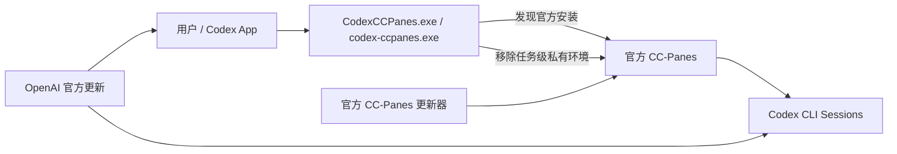

# 架构

## 当前实现状态

当前已发布能力仍是 Launcher/诊断链路：



`coordination-core`、`coordination-protocol`、`coordination-store`、`coordinator`、
`ccpanes-adapter` 与 `coordination-mcp` 已作为 Phase 7 合同 crate 加入 workspace。它们
定义领域、协议、持久化、Coordinator runtime、CC-Panes HTTP MCP Adapter seam、MCP
stdio seam、fake server、synthetic multi-worker fan-out/fan-in、容量、超时和 Writer
Lease 合同测试，并增加真实 CC-Panes 只读 capability preflight、专用合成 Git 仓库
登记/恢复 guard、专用 Workspace/Project 只读 gate、fake 单 Worker success canary 和
fake cancellation canary、fake Coordinator restart canary、fake unknown dispatch canary 和
fake Token/discovery rotation canary、fake CC-Panes process restart canary 和 fake
multi-worker controlled capacity canary；
Phase 8 首个本地包装切片已定义 release 包三组件 EXE inventory、`ARTIFACT_MANIFEST.json`、
SHA-256 全覆盖、依赖清单和隔离安装状态登记；当前切片新增合成 Codex MCP 配置事务合同，
只对显式临时 `ConfigPath` 写入托管 MCP block、备份、幂等 repair、rollback 和显式
install/uninstall 串联，并新增 `Manage-Coordinator.ps1` 生命周期入口合同，验证显式
describe/verify/foreground health/start-plan。Coordinator→Adapter 一次性前台单 Worker
execution seam 已在官方 CC-Panes `0.12.3` 新 Codex 对话上通过。本机开发验收另在显式
`ConfigPath` 授权下事务注册托管 MCP block，验证新对话能发现全局 skill/MCP 并调用该
seam；package/default install 仍不注册 MCP，也不启动后台服务、不开放通用真实 Worker
池或发布。

## 目标三组件链路


结构依赖方向：

```text
coordination-core
  ↑                 ↑                 ↑
coordination-protocol coordination-store ccpanes-adapter
  ↑                 ↑                 ↑
coordination-mcp coordinator ──────────┘
```

root launcher package 保持独立，不反向依赖 Coordinator runtime。
`coordination-mcp` 不直接依赖 `coordination-store`；所有持久状态访问必须经后续
Coordinator runtime。`coordinator` 可正向依赖 `ccpanes-adapter` 执行外部 Session
命令；Adapter 不反向依赖 Coordinator/Store/MCP/Launcher。

## 组件边界

### `CodexCCPanes.exe`

只负责官方 CC-Panes GUI 的安全启动。它不注入 DLL、不代理 PTY、不修改 CC-Panes 数据库，
也不持有 Workflow/Worker 状态。

移除的环境：

- `CODEX_INTERNAL_*`
- `CODEX_THREAD_ID`
- `CODEX_PERMISSION_PROFILE`
- `WORKFLOW_FABRIC_CONTROLLED_CODEX_LAUNCHER_ERROR`

保留的环境：

- `CODEX_HOME`
- `CODEX_API_KEY`
- `OPENAI_API_KEY`
- PATH 和用户自定义 provider 变量

### `codex-ccpanes-coordinator.exe`

目标组件。它是 Workflow、Worker、ExternalBinding、Lease、Event、Outbox、Budget 和
Result 的唯一本机生产状态源，负责并发准入、超时、重试、取消、未知结果对账和聚合。
Phase 3 已提供 `coordinator` crate 和 `codex-ccpanes-coordinator.exe` 编译目标；Phase 6
扩展合成测试覆盖单实例、IPC health、scheduler、容量、DAG fan-out、fan-in policy、
Worker/Workflow timeout、Writer Lease、取消和聚合合同。当前新增一次性前台
Coordinator→Adapter execution seam：claim launch outbox、调用 `launch_task`、轮询
status/output、验证 challenge-response + accepted final status，并收敛 Binding/Outbox/Worker/
Workflow/Result。后台注册、持续 runner、多 Worker 与真实取消/restart/unknown-outcome
留到后续门禁。
Phase 7 增加 repository baseline guard 与专用合成 Git 仓库准备合同：只在显式空目录创建
fixture，登记 marker digest、baseline HEAD 和 clean status digest，并用 parent containment
约束后续恢复/清理。RepositoryRef 可选 `workspaceName`，用于把专用 Workspace 选择传到
Adapter `launch_task` payload。

### `ccpanes-adapter`

已实现 Phase 7 合同 crate。它负责从显式 discovery 文档读取 loopback HTTP MCP endpoint
与认证 Header，执行 initialize/tools/list capability negotiation，计算 capability digest，
调用 `launch_task`、`list_sessions`、`list_panes`、`get_session_status`、
`get_session_output`、`submit_to_session`、`kill_session`、`wait_for_session` 和
`write_to_session`，并用公开 Session/Pane
listing 对账 unknown dispatch marker。只读 preflight 仅调用 initialize、
notifications/initialized、tools/list、list_sessions 和 list_panes，并输出脱敏 endpoint
与 Session inventory 摘要；dispatch 再资格 evaluator 只消费该报告，要求基础 READY、
`dispatchReady=true`、inventory 存在和零 Worker 副作用，不产生新的状态源。专用
Workspace/Project gate 只调用 list_workspaces 和
list_projects，检查 create/add tool 与 `launch_task.workspaceName` capability，返回 existing
fixture、setup plan 或 dedicated workspace path mismatch；受控 canary/launch setup 可随后执行
`create_workspace(name,path=projectPath)` 与
`add_project_to_workspace(workspaceName,projectPath)`。它不持有
Workflow/Worker 状态，不拥有重试策略，不读取或修改 CC-Panes 数据库，也不接管真实
Session。

### `codex-ccpanes-mcp.exe`

已实现 Phase 6 合同 crate 和 `codex-ccpanes-mcp.exe` 编译目标。它为 Codex App 暴露
高层 MCP 工具，验证输入并通过本机 IPC 进入 Coordinator；工具结果同时返回
`structuredContent` 与文本 JSON，并用 synthetic 测试覆盖多 Step Workflow
create/start/result。它不持久化 Workflow，不拥有调度和重试策略。package/default MCP
注册、后台 Coordinator 生命周期和真实 CC-Panes 派发属于后续门禁；本机开发验收使用
显式 `ConfigPath` 事务注册托管 MCP block 只服务于新对话入口验收。

### `coordination-store`

已实现 Phase 2 合同 crate。它负责 SQLite schema v1、WAL 打开、migration、pre-v1
backup、integrity check、Event hash chain、transactional Outbox、idempotency record、
optimistic revision CAS、ExternalBinding、Lease、Result 和 retention metadata repository。
它不包含 scheduler、IPC、MCP stdio、CC-Panes HTTP、Windows 或 Launcher 逻辑。

## 状态与合同

- `coordination-core` 拥有 ID、revision、Workflow/Worker/Outbox 状态机、WorkflowSpec
  v1beta1、DAG Step、fan-in policy、命令、查询、事件和公共错误码。
- `coordination-protocol` 拥有 MCP/IPC schema version、公共工具 DTO、JSON Schema
  合同、version negotiation 和 WorkflowResult 来源/缺失/失败合同。
- `coordination-store` 拥有 SQLite 持久化合同、migration、Event/Outbox/Binding/Lease/
  Result repository、external launch success→Binding ACTIVE 记录、幂等记录、retention
  元数据和 Store 级恢复检查。
- `coordinator` 拥有 runtime identity、单实例锁、IPC health handler、scheduler、
  capacity/budget admission、DAG fan-out、fan-in policy、Worker/Workflow timeout、
  dispatch/reconcile/control semaphore、pause/resume/cancel、result aggregation、
  metrics/log snapshot、repository baseline guard、专用合成 Git 仓库登记/恢复 guard，
  以及通过 `ccpanes-adapter` 执行的一次性前台单 Worker canary；它不拥有 CC-Panes HTTP
  协议翻译、MCP stdio、安装注册或通用后台外部执行。
- `ccpanes-adapter` 拥有 CC-Panes HTTP MCP 外部协议翻译、capability/readiness 快照、
  工具错误映射、认证 Header 注入、只读 preflight、dispatch 再资格判定、专用
  Workspace/Project gate 和 unknown dispatch 候选匹配；它不提交状态转换或 Workspace
  创建决定。
- v0.12.3 cwd 路由由 Coordinator 与 Adapter 分工：Coordinator 从 `projectPath` 生成
  `codex-ccpanes-phase7-<sha256-prefix>` 作为 `launchWorkspaceName`，把调用来源
  `workspaceName` 仅作为 `sourceWorkspaceName` 元数据保留；Adapter 在受控 setup 门内确保
  该 Workspace 的 `path=projectPath` 并把 project 加入该 Workspace。这样官方 CC-Panes
  即使用 Workspace `path` 作为终端 cwd，新对话也落在目标目录；prompt 不承担目录切换。
- `coordination-mcp` 拥有 MCP stdio JSON-RPC、工具列表、输入验证、错误映射和 IPC client
  seam；它不读取 Store，不保存 Workflow 状态。
- fake success canary 在专用合成仓库和 existing Workspace/Project fixture 下验证
  `worker_dispatch.repository.workspaceName`、fake `launch_task`、ExternalBinding session ref
  与 `workflow_result` complete。一次性前台真实 canary 复用该 seam，在官方 CC-Panes
  `0.12.3` 新建 Codex 对话并验证 Worker 生成的 Unicode 逆序 challenge response +
  `idle`、Store success convergence 和 submit/kill/write=0；expected response 不进入
  prompt，后台、多 Worker 和真实控制仍属后续门禁。
- fake cancellation canary 在专用合成仓库和 existing Workspace/Project fixture 下验证
  active Binding 的 `workflow_cancel`/`worker_cancel` 进入 `CANCEL_REQUESTED`，只产生一个
  `kill_session` 控制 outbox，fake kill/reconcile 后 Binding、Worker、Workflow 和 Result
  收敛；真实 Session 控制接线仍属后续门禁。
- fake Coordinator restart canary 重新打开同一合成 SQLite DB，验证重启前 active Worker
  的 Workflow/Binding/Outbox 状态可由 MCP 查询，tick 不重复派发，fake reconcile 后由
  重启后的 Runtime 记录 Result 并聚合 complete；后台进程 supervisor 与真实 CC-Panes
  restart 仍属后续门禁。
- fake unknown dispatch canary 验证 fake `launch_task` 已创建 Session 但响应丢失时，Store
  在 launch 错误路径立即将 Outbox/Binding 记录为 `RESULT_UNKNOWN`、Worker 记录为
  `DISPATCH_UNKNOWN`，reopen 后保持该状态；Adapter 通过 list_sessions/list_panes 找回原
  fake Session，随后 Binding/Worker/Result 聚合收敛；真实 CC-Panes unknown outcome 验收
  仍属后续门禁。
- fake Token/discovery rotation canary 验证 fake endpoint/token A→B 时，旧 token 对新 endpoint
  映射为 `authorization_failed`，新 discovery generation/token 可刷新 readiness 与 capability
  digest，报告和 fake request record 只保留 Header digest；真实 discovery 读取由独立
  read-only dispatch 再资格 gate 执行，不从 fake rotation 证据外推。
- fake CC-Panes process restart canary 验证 fake endpoint A 停止后旧 adapter preflight/
  reconcile 降级为 `adapter_not_ready`/DEGRADED，Coordinator/MCP 仍可查询 RUNNING
  Worker 和 ACTIVE Binding，dispatch freeze 与 readiness 恢复后 tick 均不重复 `launch_task`，
  fake endpoint B 携带同一 synthetic Session 后可 reconcile 并聚合 complete；真实
  CC-Panes process restart、后台进程 supervisor 和真实 Session 恢复仍属后续门禁。
- fake multi-worker controlled capacity canary 验证 MCP `workflow_create/start` 创建 6 个只读
  Step 后，Coordinator 在 host/dispatch/per-workflow cap=3 下只分两批通过 fake Adapter
  `launch_task`，active/queued 计数受控，重复 tick 不重复 launch，Binding/Session 与
  `clientRequestId` 唯一，`workflow_result` complete 保留全部 `stepId` 来源；真实多
  Session 容量和真实 Worker 池仍属后续门禁。
- Phase 8 package inventory and manifest local contract 将 `CodexCCPanes.exe`、
  `codex-ccpanes-coordinator.exe`、`codex-ccpanes-mcp.exe` 作为三个产品组件 EXE，并保留
  `codex-ccpanes.exe` 作为辅助 CLI。包内 `ARTIFACT_MANIFEST.json` 声明组件 inventory 和
  副作用边界；`SHA256SUMS` 覆盖全部包文件；安装状态登记 CLI、GUI、Coordinator 和 MCP
  路径。该合同不注册用户 MCP、不启动后台 Coordinator、不修改官方 Codex/CC-Panes 或真实项目。
- Phase 8 synthetic Codex MCP config transaction contract 由 `Configure-CodexMcp.ps1` 拥有，
  入口必须显式传入 `ConfigPath`、`InstallRoot` 和 `McpExecutable`；写入前记录 before
  snapshot 与 backup，`Repair` 复用同一托管 block，`Rollback` 依据 transaction JSON 恢复
  原 SHA-256 或 absent 状态。`Install-CodexCCPanes.ps1` 仅在显式
  `-ConfigureCodexMcp -CodexConfigPath <path>` 时调用 apply/repair，
  `Uninstall-CodexCCPanes.ps1` 仅在显式 `-RemoveCodexMcp -CodexConfigPath <path>` 时
  移除托管 block。当前测试只使用临时 Codex config，不调用真实 `codex mcp`。
- Phase 8 coordinator lifecycle entry contract 由 `Manage-Coordinator.ps1` 拥有。它从
  `install-state.json`/`current.json` 解析已安装 Coordinator，`Describe` 与 `Verify` 无后台
  进程副作用，`Health` 前台打开 install-root 子目录中的 SQLite DB 并立即退出，`StartPlan`
  仅返回 `--stdio-ipc` 命令计划；默认安装不启动后台 Coordinator，不注册 service、scheduled
  task 或自启动项。
- Phase 8 external acceptance + beta notes contract 由包内
  `EXTERNAL_WINDOWS_ACCEPTANCE.md`、`Test-ExternalWindowsAcceptance.ps1` 和
  `RELEASE_NOTES_0.2.0-beta.1.md` 拥有，并在 `ARTIFACT_MANIFEST.json` 中声明。它只定义
  外部 Windows x64 机器验收步骤、记录格式、package 副作用边界、默认未启用能力和已知限制；
  runner 只在 `%TEMP%` 下创建临时 install root 与 synthetic Codex config。当前门禁只验证这些
  合同随包和安装版本根交付，外部机器实际执行、版本发布与签名仍属后续门禁。
- `DISPATCH_UNKNOWN` 表示外部派发结果未知；它是正式持久状态，不等价于失败。
- `CANCELLING` 表示取消已被接受且仍在收敛；终态为 `SUCCEEDED`、`PARTIAL_FAILED`、
  `FAILED` 或 `CANCELLED`。

## 升级兼容

Launcher 每次启动都重新发现官方可执行文件，不缓存版本路径。发现顺序：

1. `--ccpanes-bin`
2. `CODEX_CCPANES_EXE`
3. `%LOCALAPPDATA%\cc-panes\cc-panes.exe`
4. `%LOCALAPPDATA%\Programs\cc-panes\cc-panes.exe`
5. `%ProgramFiles%\cc-panes\cc-panes.exe`
6. PATH

版本字符串只用于诊断。三组件链路的上游兼容性由 protocol、tool inventory 和 input schema
决定。

当前已知合成兼容快照为官方 CC-Panes `v0.12.3` (`7fad08d`)：

- 基础 READY 只依赖 `launch_task`、`list_sessions`、`list_panes`；
- `get_session_status` 与 `get_session_output` 共同决定 `dispatchReady`，缺失时在
  `launch_task` 外部副作用前 fail closed；
- 官方更新后的常规 runner 还要求 Session inventory 存在和
  `externalWorkerSideEffects=false`，失败以 typed error 非零退出；
- submit/kill/wait/write 是逐工具 capability，不构成全局固定 required tool table；
- 输出翻译在 Adapter 边界归一化 v0.12.3 `content`/`lines` 和历史 `output`；
- `kill_session.reason` 与其他可选参数只在 negotiated schema 接受时发送。
- `workspaceName` 的运行语义是“launch workspace”，不是调用来源 workspace；source
  workspace 只保留为元数据，实际 `launch_task.workspaceName` 始终是由 `projectPath`
  摘要生成的专用 workspace。Canary 通过 `CCPANES_CANARY_CWD` 输出 marker 验证 observed
  cwd digest 与期望 projectPath digest 匹配，缺失或不匹配均 fail closed。

该策略使上游 `docs/89-mcp-tool-surface-reduction.md` 的后续工具面收编只影响实际使用的
能力，不改变 Coordinator/Core/Store 的权威状态。本机真实 read-only preflight 已返回
READY；一个专用合成项目的新 Codex 对话已验证
`Coordinator → Adapter MCP launch_task → get_session_status/get_session_output → Store`
前台链路，Worker 计算出的 Unicode 逆序 challenge response 可见且最终状态为 `idle`；
expected response 未进入 prompt。该单次 canary 不证明后台 Coordinator、多 Worker E2E、
真实 Session 控制、restart 或 unknown-outcome 已通过 v0.12.3 验收。

用户级入口验收从官方 CC-Panes `0.12.3` 新建独立 Codex 对话，确认
`codex-ccpanes-companion` 注入、`codex_ccpanes` 工具发现和 preflight READY；随后一次
synthetic canary 收敛为 `launch/submit/kill/write=1/0/0/0`、Session `idle`、
Binding/Outbox/Worker/Workflow/Result
`ACTIVE/ACKNOWLEDGED/SUCCEEDED/SUCCEEDED/complete`，`launchWorkspaceName` 为 projectPath
专用 workspace，`cwdMatched=true`，`acceptancePassed=true`。这仍只签署专用合成项目的
一次性前台 success path。

## 数据与隐私

默认诊断报告只包含：

- 路径 SHA-256，而不是明文路径；
- 可执行文件 SHA-256、大小和版本；
- 环境变量名称，不包含值；
- 进程名称和数量，不包含命令行；
- 配置文件存在状态和哈希，不包含内容。

后续 Coordinator Event、Artifact 和错误报告沿用同一脱敏原则，且不写入 Token、
Authorization、Session ID 明文或未经脱敏的完整用户路径。
